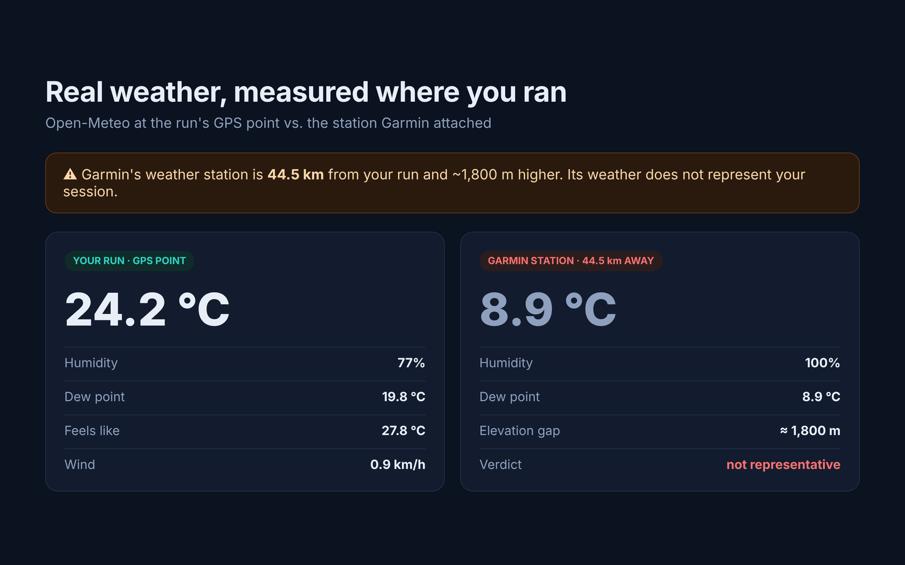

# garmin-coach-mcp

A remote MCP server that connects Claude (or any MCP client) to **your own** Garmin Connect
account: activities, splits, HR and power zones, aerobic decoupling, HRV, sleep, stress,
readiness, training status, gear, personal records, session weather — and it can create,
schedule and delete running, strength and swim workouts on your watch.

It runs in the cloud, so it also works from the Claude mobile app.



[](https://render.com/deploy?repo=https://github.com/herazofelipe/garmin-coach-mcp)

> **Español:** instrucciones al final.

**Want coach-grade analysis on top of the data?** The
[Garmin Run Coach](https://agensi.io/skills/garmin-run-coach) skill on Agensi teaches your agent to
use these tools well: decoupling on the steady block, weather-corrected heart rate, readiness
calls and workouts that upload cleanly.

## How it stays private

- **Everyone deploys their own copy.** Your Garmin credentials live only in *your* Render
  account's environment variables. This repo contains no credentials and no personal data.
- **The connector URL is the key.** Render generates a random `MCP_SECRET`; the endpoint is
  `https://<your-service>.onrender.com/mcp/<secret>`. Without it, the server answers nothing
  but `/health`. The server refuses to start in the cloud without a secret.
- **Nothing is sent anywhere else**, except Open-Meteo (coordinates and time only) when you
  ask for session weather.

## Setup (about 10 minutes)

1. **Deploy.** Click *Deploy to Render* (free account). Render asks for:
   - `GARMIN_EMAIL`, `GARMIN_PASSWORD` — your Garmin Connect login. Works directly if your
     account has no two-factor authentication (MFA).
   - `GARMIN_TOKENS` — leave empty, unless your account uses MFA (see below).
   - `LOCAL_TZ_OFFSET_HOURS` — your offset from UTC (e.g. `-5`, `-6`, `1`).
   - `MCP_SECRET` is generated for you.
2. **Get your connector URL.** When the deploy is *Live*, open the service's **Logs**: the
   server prints `Conector MCP: https://<tu-servicio>.onrender.com/mcp/...`. Replace
   `<tu-servicio>` with your service's address (shown at the top of the Render page).
   Keep this URL private.
3. **Add it to Claude.** claude.ai (web) → Settings → Connectors → *Add custom connector* →
   paste the URL. It then works in the web, desktop and mobile apps. Test with
   *"check my Garmin connection"*.
4. **Keep it awake (recommended).** Render's free plan sleeps after 15 minutes without traffic.
   Create a free [UptimeRobot](https://uptimerobot.com) HTTP(s) monitor on
   `https://<your-service>.onrender.com/health` every 5 minutes. Use only `/health` there,
   never the URL with your secret. One always-on service fits Render's 750 free hours a month.

**Accounts with MFA:** run `garmin_login.py` on your computer, or open
`garmin_login_colab.ipynb` in Google Colab from your phone. Paste the printed value into
`GARMIN_TOKENS` in Render. Treat it like a password.

## Tools (41)

| Group | Tools |
|---|---|
| Activities | list, by date, last, full analysis (summary, splits, typed splits, zones, optional weather), compare, progress summary, personal records |
| Derived metrics | aerobic decoupling Pa:HR / Pw:HR on the active block, cardiac drift, HR recovery, HR curve |
| Daily physiology | morning check, HRV (+detail), sleep, stress, Body Battery events, daily summary, altitude vitals, body composition, hydration |
| Trends | `garmin_get_trend` for HRV, sleep, resting HR, stress, VO2max, SpO2, respiration (31 days) or Body Battery, intensity minutes, hill and endurance score (366 days); readiness range |
| Intraday | heart rate and stress for a time window |
| Status | training status (load, ACWR, load balance, acclimation, race predictions), calibration (LTHR, threshold pace/power, VO2max) |
| Strength & swim | session detail, exercise search and validation |
| Writing | create running/strength/swim workouts, inspect, delete, calendar, schedule/unschedule, gear, set activity gear |

**Session weather** (`include_weather=true` in the activity analysis): Garmin uses its nearest
weather station, which can be tens of km away. The server also queries Open-Meteo at the run's
GPS point for the hours nearest start and end, and warns when Garmin's station is > 15 km away.

Tool descriptions are in Spanish; Claude answers in your language anyway.

## Important

- **Unofficial access.** This uses [`python-garminconnect`](https://github.com/cyberjunky/python-garminconnect),
  which talks to Garmin Connect the way the website does. It is not affiliated with or endorsed
  by Garmin, and Garmin can change or block it at any time. Use it with your own account only.
  Garmin also offers an official [Personal API](https://developer.garmin.com/gc-developer-program/personal/personal-faq/)
  (read-only, your own data).
- **Not a medical device.** Heart-rate metrics are training indicators, not clinical measurements.
- **Exercise catalog.** Strength exercise names are validated against a catalog generated at
  build time from Garmin's official `garmin-fit-sdk` package (FIT Protocol License). It is not
  included in this repo.
- **Open-Meteo** is free for non-commercial use; personal analysis of your own runs fits that.

## Run locally

```bash
pip install -r requirements.txt "garmin-fit-sdk>=21,<22"
python build_exercise_catalog.py
export GARMIN_EMAIL="..." GARMIN_PASSWORD="..."      # or GARMIN_TOKENS
HOST=127.0.0.1 PORT=8000 python garmin_mcp_server.py # MCP at http://127.0.0.1:8000/mcp
```

## License

MIT for the code in this repo. See `LICENSE`.

---

## Español

Servidor MCP para conectar Claude con **tu propia** cuenta de Garmin Connect. Cada persona
despliega su copia; tus credenciales quedan solo en tu cuenta de Render. Para análisis de
entrenador sobre estos datos, existe el skill
[Garmin Run Coach](https://agensi.io/skills/garmin-run-coach) en Agensi.

1. Pulsa **Deploy to Render**. Escribe tu correo y contraseña de Garmin (cuentas sin
   verificación en dos pasos) y tu desfase horario (Bogotá/Lima `-5`, Ciudad de México `-6`).
   El secreto `MCP_SECRET` se genera solo.
2. Cuando diga *Live*, abre **Logs** y copia la línea `Conector MCP: ...`. Cambia
   `<tu-servicio>` por la dirección de tu servicio. Esa URL es tu llave: no la compartas.
3. En claude.ai (web) → Ajustes → Conectores → *Agregar conector personalizado* → pega la URL.
4. Opcional: un monitor gratis de UptimeRobot a `.../health` cada 5 minutos para que no se duerma.

Si tu cuenta usa verificación en dos pasos, genera `GARMIN_TOKENS` con
`garmin_login_colab.ipynb` (Google Colab, funciona desde el celular).
